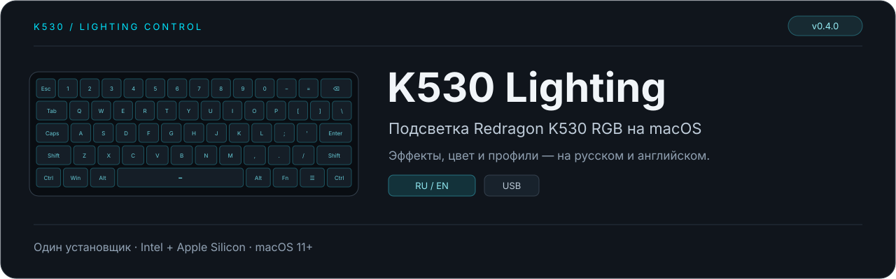

<p align="center"></p>

**Русский** | [English](README_EN.md)

# K530 Lighting

Нативное приложение macOS для управления подсветкой **Redragon K530 RGB / Draconic** по USB (`0C45:5004`, Sonix). Текущая версия — **0.4.0**, macOS 11+, один универсальный установщик для **Intel и Apple Silicon**.

Интерфейс и встроенная справка доступны на русском и английском. Кнопка RU/EN рядом с шестерёнкой меняет язык сразу и сохраняет выбор после перезапуска.

Приложение неофициальное и не связано с Redragon. Протокол восстановлен по штатной программе и проверен на одной клавиатуре; другие аппаратные ревизии могут отличаться.

## Установка

1. Откройте [последний релиз](https://github.com/Slipcast-dev/Rdragon-K530RGB-Keyboard-Port/releases/latest) и скачайте `K530Lighting-0.4.0-macOS-universal.dmg`. Для приватного репозитория требуется доступ и вход в GitHub.
2. Завершите старую копию, перетащите `K530Lighting.app` из образа в «Программы», затем извлеките образ.
3. Откройте приложение. Сборка подписана ad-hoc и не нотаризована; используйте штатное действие macOS «Открыть» для доверенного приложения.
4. Подключите клавиатуру **USB-кабелем**, разрешите **«Мониторинг ввода»** в системных настройках и перезапустите приложение. После обновления разрешение может потребоваться выдать заново.

ZIP — альтернативная упаковка той же универсальной `.app`. Решение проблем — в [FAQ](docs/FAQ_RU.md), также доступном из приложения.

## Возможности

- Переключение русского/английского языка без перезапуска; обе верхние кнопки имеют размер 36 × 36.
- 19 эффектов, яркость 0–4 и пять уровней скорости.
- Готовые цвета, HEX, палитра macOS и «Разноцветный».
- Именованные локальные профили с отдельными настройками и черновиками.
- Изменения в предпросмотре и запись кнопкой «Применить» с обратной проверкой.
- Возврат исходного состояния и резервная копия перед первой записью.
- Открытая панель отображается в Dock; после закрытия приложение остаётся в строке меню.
- Левый щелчок значка открывает панель, правый — быстрые настройки и управление приложением.
- Автозапуск и встроенная справка.

Профили приложения сохраняются на Mac. «Применить» записывает выбранный набор **во все три аппаратных профиля** клавиатуры; активный аппаратный профиль не переключается. Подсветка сохраняется после закрытия приложения.

## Ограничения

- Bluetooth, макросы, переназначение клавиш и обновление прошивки не поддерживаются.
- Эффекты 4, 11, 12, 17, 18 и 20 используют собственную палитру; выбор цвета для них отключён.
- Предпросмотр показывает общий цвет, а не точную аппаратную анимацию.
- Сборка arm64 включена; полноценная аппаратная приёмка на Apple Silicon ещё необходима.
- Фоновый модуль обновлений проверяет подпись Ed25519 и SHA-256, показывает прогресс и перезапускает приложение. **Пока репозиторий приватный, текущая проверка без авторизации не получает его релизы** — скачивайте их вручную через GitHub. Токены в приложение не включаются. [Подробнее](docs/UPDATES_RU.md).

[Подтверждённые проверки и оставшиеся ограничения](docs/VALIDATION_RU.md).

## Разработка

Нужны macOS и Command Line Tools (`xcode-select --install`); сторонние библиотеки и полный Xcode не требуются. Выполните из корня проекта:

```sh
./tools/k530menu/test.sh                # проверки без клавиатуры и сети
./tools/k530menu/build.sh universal     # Intel + Apple Silicon
open tools/k530menu/.build/K530Lighting.app
```

`./tools/k530menu/build.sh universal install` копирует сборку в `~/Applications`, заменяя предыдущую локальную копию. Скрипт `./tools/k530menu/package.sh` создаёт DMG, ZIP и подписанные файлы обновления в `dist/`; для него нужен закрытый ключ выпуска вне репозитория.

- [Архитектура, поведение интерфейса и сборка](docs/INTERFACE_RU.md)
- [Упаковка и подпись релизов](docs/UPDATES_RU.md)
- [Протокол HID и подтверждающие данные](research/protocol-findings.md)

При изменении документации обновляйте обе языковые версии; исходные дампы устройства сохраняются без перевода.

## Структура

| Путь | Назначение |
|---|---|
| `tools/k530menu/` | Приложение Swift/AppKit/SwiftUI, тесты и скрипты выпуска |
| `tools/k530diag/` | Диагностика HID и исследовательские команды |
| `docs/` | Актуальная справка, архитектура и выпуск |
| `research/` | Описание протокола и необходимые данные реального устройства |
| `dist/` | Локальные артефакты выпуска; публикуются в Releases, не хранятся в Git |

## Лицензия и безопасность

Новый код распространяется по [MIT](LICENSE). Лицензия не распространяется на стороннюю графику и материалы производителя — см. [NOTICE](NOTICE.md). Условия использования исходной эмблемы иконки требуют проверки перед распространением.

Приложение не меняет прошивку и неизвестные поля профиля. Для сообщений об уязвимостях используйте [политику безопасности](SECURITY.md); для ошибок — Issues с версией приложения, macOS и текстом состояния.
