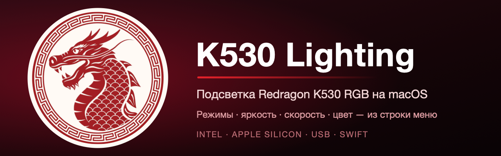

<p align="center"></p>

<p align="center">
  
  
  
  
  
  
</p>

# K530 Lighting — подсветка Redragon K530 RGB на macOS

Приложение в строке меню macOS для управления подсветкой клавиатуры **Redragon K530 RGB** (USB `0C45:5004`, Sonix). Заменяет штатную программу, которая работает только в Windows. Протокол обмена восстановлен статическим анализом штатной программы, поэтому проект неофициальный и не связан с Redragon.

## Возможности

- 19 режимов подсветки (с пометкой, какие из них используют выбранный цвет);
- яркость (0–4) и скорость анимации (5 уровней);
- цвет: готовые цвета, «Разноцветный» и любой цвет через палитру macOS;
- откат к состоянию на момент запуска и автоматическая резервная копия профилей;
- автозапуск при входе в систему;
- встроенная справка (FAQ);
- универсальная сборка для Intel и Apple Silicon.

Настройки записываются в саму клавиатуру (во все три профиля) и сохраняются после выключения приложения.

## Установка и запуск

1. Скачайте `K530Lighting-…-macOS-universal.zip` на странице **Releases** и распакуйте архив.
2. Перетащите `K530Lighting.app` в «Программы». Первый запуск — правой кнопкой → «Открыть» (приложение не нотаризовано).
3. Выдайте приложению доступ «Системные настройки → Конфиденциальность и безопасность → Мониторинг ввода» и перезапустите его.
4. Подключите клавиатуру **USB-кабелем** и откройте меню со значком дракона в строке меню.

Подробности и решение проблем — в [FAQ](docs/FAQ_RU.md) (она же доступна в приложении: «Справка (FAQ)…»).

## Сборка из исходников

Нужны macOS и Command Line Tools (`xcode-select --install`), Xcode не требуется.

```sh
git clone https://github.com/Slipcast-dev/Rdragon-K530RGB-Keyboard-Port.git
cd Rdragon-K530RGB-Keyboard-Port/tools/k530menu
./build.sh universal install    # Intel + Apple Silicon, копирует приложение в ~/Applications
```

Подпись ad-hoc, поэтому после каждой пересборки macOS просит выдать доступ «Мониторинг ввода» заново.

## Состояние проекта

| Функция | Статус |
|---|---|
| Режим, яркость, цвет, скорость | проверено на реальной клавиатуре (Intel, USB) |
| Универсальная сборка | arm64-часть собрана, на Apple Silicon не запускалась |
| Bluetooth | не поддерживается |
| Макросы, переназначение клавиш, прошивка | не реализованы и не затрагиваются |

Какие режимы используют цвет: 1–3, 5–10, 13–16. Режимы 4, 11, 12, 17, 18 и 20 используют собственную палитру.

## Состав репозитория

| Путь | Назначение |
|---|---|
| `tools/k530menu/` | Приложение K530 Lighting (Swift/AppKit), скрипт сборки, иконки |
| `tools/k530diag/` | Диагностическая утилита: дескрипторы, чтение профилей, проверка режимов и цвета |
| `docs/FAQ_RU.md` | Установка, запуск, использование, решение проблем |
| `docs/PORTING_PLAN_RU.md`, `docs/HANDOFF_RU.md`, `docs/BACKLOG_RU.md` | План портирования, передача контекста, задачи |
| `research/protocol-findings.md` | Восстановленный протокол: формат пакетов, команды, схема профиля |
| `research/device/` | Дескрипторы реальной клавиатуры, чтения профилей, результаты проверок |
| `installers/` | Исходный Windows-установщик без изменений |
| `research/manifest.json`, `ARTIFACTS.json`, `hid-descriptor-candidates.json` | Хеши и данные статического анализа |

## Как это работает

Клавиатура принимает команды через служебный HID-отчёт `FF1C:0092` (Report ID 4, 64 байта). Пакет содержит контрольную сумму, команду, длину и адрес; настройки лежат в трёх профилях по 42 байта (байт 0 — режим, 1 — яркость, 2 — скорость, 4 — флаг «разноцветный», 5–7 — цвет RGB). Полное описание — в [research/protocol-findings.md](research/protocol-findings.md).

## Ограничения и безопасность

- Проект основан на реверс-инжиниринге и проверен на одной клавиатуре; на других ревизиях может не работать. Используйте на свой риск.
- Приложение записывает только поля режима, яркости, скорости и цвета; прошивку и макросы не затрагивает. Опасные и неизученные команды (в том числе функция с байтами `EE EE`) в проект не включены.
- Иконка приложения построена на картинке стороннего автора (по имени файла — Freepik); условия её использования не проверялись — см. `tools/k530menu/Icon/source/README.md`.
- Исходный Windows-установщик опубликован по явному запросу владельца репозитория. Его включение не меняет лицензию производителя и не означает предоставления прав на фирменные бинарники или графические ресурсы. Отдельная лицензия нового проекта пока не выбрана.

---

## Материалы исследования

### С чего продолжить на другом компьютере

1. Прочитать [передачу контекста](docs/HANDOFF_RU.md).
2. Изучить [подробный план портирования](docs/PORTING_PLAN_RU.md).
3. Выполнять [задачи по порядку](docs/BACKLOG_RU.md), начиная с дескрипторов реальной K530.
4. Для повторного анализа использовать [исходный установщик](installers/Rdragon%20K530RGB%20Keyboard%20-%20Port.exe), включённый в репозиторий. Полный ZIP исследования пока остаётся на исходном компьютере.

```sh
git clone https://github.com/Slipcast-dev/Rdragon-K530RGB-Keyboard-Port.git
cd Rdragon-K530RGB-Keyboard-Port
```

Документы и исходный установщик доступны сразу после клонирования. Для восстановления полного снимка потребуется отдельно перенести `static-analysis.zip` с исходного компьютера. Подробности — в инструкции передачи контекста.

### Файлы исследования

| Путь | Назначение |
|---|---|
| `docs/PORTING_PLAN_RU.md` | Анализ, архитектура, варианты реализации, этапы и оценки |
| `docs/HANDOFF_RU.md` | Контекст, доказанные факты, неизвестные параметры, следующий шаг |
| `docs/BACKLOG_RU.md` | Чек-лист реализации и критерии проверки |
| `installers/Rdragon K530RGB Keyboard - Port.exe` | Исходный Windows-установщик без изменений |
| `research/manifest.json` | Размеры и SHA-256 127 извлечённых файлов |
| `research/ARTIFACTS.json` | SHA-256 исходного установщика и ZIP-снимка |
| `research/hid-descriptor-candidates.json` | Байты предполагаемых HID-структур |

Исходный установщик находится в `installers/`. Проверить его на macOS можно так:

```sh
shasum -a 256 'installers/Rdragon K530RGB Keyboard - Port.exe'
```

На Windows:

```powershell
Get-FileHash -Algorithm SHA256 -LiteralPath 'installers/Rdragon K530RGB Keyboard - Port.exe'
```

Ожидаемый SHA-256: `de4b11b71805fc0ea76452a7c9fbe74b67a044e3a67caa538b548a3041f4c573`.

### Исходное направление реализации

Предлагается Swift/SwiftUI + пользовательский HID API IOKit, сборка Universal 2 (`x86_64` + `arm64`). Сначала USB и штатная прошивка; Bluetooth, прошивальщик и замена прошивки рассматриваются отдельно после подтверждения возможностей устройства.

Предполагаемые VID/PID `0C45:5004` получены из статических данных, а не с физической клавиатуры. Нельзя считать их достаточным подтверждением совместимости. Наличие функции в ресурсах также не подтверждает её поддержку конкретной аппаратной ревизией.

Исходный Windows-установщик опубликован по явному запросу владельца репозитория. Его включение не меняет лицензию производителя и не означает предоставления прав на фирменные бинарники или графические ресурсы. Полный архив исследования пока остаётся локальным. Отдельная лицензия нового проекта пока не выбрана.
