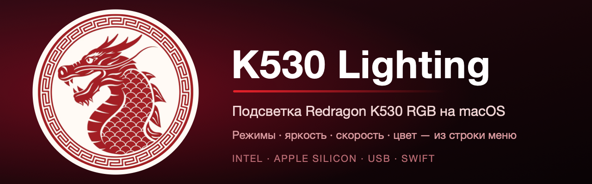

<p align="center"></p>

<p align="center">
  
  
  
  
  
  
</p>

# K530 Lighting — подсветка Redragon K530 RGB на macOS

Приложение в строке меню macOS для управления подсветкой клавиатуры **Redragon K530 RGB** (USB `0C45:5004`, Sonix). Заменяет штатную программу, которая работает только в Windows. Протокол обмена восстановлен статическим анализом штатной программы, поэтому проект неофициальный и не связан с Redragon.

## Возможности

Версия 0.3.0: компактная SwiftUI-панель с читаемым заголовком, одинаковыми кнопками и закреплённой строкой состояния; именованные локальные профили; левый щелчок значка открывает панель, правый — быстрое меню. Фоновые обновления предлагают «Скачать / Позже», показывают прогресс и перезапускают приложение после установки. [Интерфейс и сборка](docs/INTERFACE_RU.md), [подготовка подписанных обновлений](docs/UPDATES_RU.md). Автоустановка принимает только выпуски с корректно подписанным описанием.

- 19 режимов подсветки (с пометкой, какие из них используют выбранный цвет);
- яркость (0–4) и скорость анимации (5 уровней);
- цвет: готовые цвета, «Разноцветный» и любой цвет через палитру macOS;
- локальные профили: выбор, сохранение, переименование, создание и удаление;
- откат к состоянию на момент запуска и автоматическая резервная копия профилей;
- автозапуск при входе в систему;
- встроенная справка (FAQ);
- универсальная сборка для Intel и Apple Silicon.

Локальные профили приложения хранят разные наборы настроек на Mac. «Применить» записывает выбранный набор в саму клавиатуру (во все три её аппаратных профиля); настройки сохраняются после выключения приложения. Команда переключения активного аппаратного профиля не используется.

## Установка и запуск

1. Откройте `dist/K530Lighting-0.3.0-macOS-universal.dmg` в локальном проекте или образ опубликованного релиза. Альтернатива — ZIP, который нужно распаковать.
2. Перетащите `K530Lighting.app` в «Программы». Первый запуск — правой кнопкой → «Открыть» (приложение не нотаризовано).
3. Выдайте приложению доступ «Системные настройки → Конфиденциальность и безопасность → Мониторинг ввода» и перезапустите его.
4. Подключите клавиатуру **USB-кабелем**. Левый щелчок значка в строке меню открывает панель, правый — меню быстрых действий.

Подробности и решение проблем — в [FAQ](docs/FAQ_RU.md) (она же доступна в приложении: «Справка (FAQ)…»).

## Сборка из исходников

Нужны macOS и Command Line Tools (`xcode-select --install`), Xcode не требуется.

```sh
git clone https://github.com/Slipcast-dev/Rdragon-K530RGB-Keyboard-Port.git
cd Rdragon-K530RGB-Keyboard-Port/tools/k530menu
./build.sh universal install    # Intel + Apple Silicon, копирует приложение в ~/Applications
```

Подпись ad-hoc, поэтому после пересборки macOS может потребовать заново разрешить «Мониторинг ввода».

Из корня проекта команда `./tools/k530menu/package.sh` собирает универсальный выпуск в `dist/`: установочный DMG, ZIP, SHA256SUMS и подписанные `update.json` / `update.json.sig`. Закрытый ключ хранится вне репозитория. Сборка установщика и публикация — разные действия: скрипт ничего не отправляет в GitHub.

Локальный Git-репозиторий содержит исходники и документацию; `.build/`, `dist/` и закрытые ключи исключаются из коммитов. [Текущие задачи и ограничения](docs/BACKLOG_RU.md).

## Состояние проекта

[Результаты проверки локального выпуска 0.3.0](docs/VALIDATION_RU.md).

| Функция | Статус |
|---|---|
| Режим, яркость, цвет, скорость | проверено на реальной клавиатуре (Intel, USB) |
| Универсальная сборка | arm64-часть собрана, на Apple Silicon не запускалась |
| Локальные профили, новая панель и меню значка | реализованы; аппаратная/визуальная приёмка рассматривается отдельно от unit-тестов |
| Подписанные обновления | модуль и локальная упаковка; полный сетевой цикл требует опубликованного подписанного релиза |
| Bluetooth | не поддерживается |
| Макросы, переназначение клавиш, прошивка | не реализованы и не затрагиваются |

Какие режимы используют цвет: 1–3, 5–10, 13–16. Режимы 4, 11, 12, 17, 18 и 20 используют собственную палитру.

## Состав репозитория

| Путь | Назначение |
|---|---|
| `tools/k530menu/` | Приложение Swift/AppKit/SwiftUI, тесты, сборка и упаковка |
| `dist/` | Локальные DMG, ZIP, контрольные суммы и файлы обновления (не в Git) |
| `tools/k530diag/` | Диагностическая утилита: дескрипторы, чтение профилей, проверка режимов и цвета |
| `docs/FAQ_RU.md` | Установка, запуск, использование, решение проблем |
| `docs/PORTING_PLAN_RU.md`, `docs/HANDOFF_RU.md`, `docs/BACKLOG_RU.md` | План портирования, передача контекста, задачи |
| `research/protocol-findings.md` | Восстановленный протокол: формат пакетов, команды, схема профиля |
| `research/device/` | Дескрипторы реальной клавиатуры, чтения профилей, результаты проверок |
| `research/manifest.json`, `ARTIFACTS.json`, `hid-descriptor-candidates.json` | Хеши и данные статического анализа |

## Как это работает

Клавиатура принимает команды через служебный HID-отчёт `FF1C:0092` (Report ID 4, 64 байта). Пакет содержит контрольную сумму, команду, длину и адрес; настройки лежат в трёх профилях по 42 байта (байт 0 — режим, 1 — яркость, 2 — скорость, 4 — флаг «разноцветный», 5–7 — цвет RGB). Полное описание — в [research/protocol-findings.md](research/protocol-findings.md).

## Ограничения и безопасность

- Проект основан на реверс-инжиниринге и проверен на одной клавиатуре; на других ревизиях может не работать. Используйте на свой риск.
- Приложение записывает только поля режима, яркости, скорости и цвета; прошивку и макросы не затрагивает. Опасные и неизученные команды (в том числе функция с байтами `EE EE`) в проект не включены.
- Иконка приложения построена на картинке стороннего автора (по имени файла — Freepik); условия её использования не проверялись — см. `tools/k530menu/Icon/source/README.md`.
- Исходный Windows-установщик производителя в репозиторий не входит (удалён). Новый код проекта распространяется по лицензии [MIT](LICENSE); она **не распространяется** на установщик, фирменные бинарники и графику производителя и стороннюю графику (см. [NOTICE.md](NOTICE.md)).

---

## Материалы исследования

### С чего продолжить на другом компьютере

1. Прочитать [передачу контекста](docs/HANDOFF_RU.md).
2. Изучить [подробный план портирования](docs/PORTING_PLAN_RU.md).
3. Свериться с [актуальным планом задач](docs/BACKLOG_RU.md). Документы портирования и передачи контекста ниже содержат также исторические сведения первоначального исследования.
4. Для повторного анализа понадобится исходный установщик производителя (в репозиторий не включён; проверка по SHA-256 ниже). Полный ZIP исследования пока остаётся на исходном компьютере.

```sh
git clone https://github.com/Slipcast-dev/Rdragon-K530RGB-Keyboard-Port.git
cd Rdragon-K530RGB-Keyboard-Port
```

Документы доступны сразу после клонирования. Для восстановления полного снимка потребуется отдельно перенести `static-analysis.zip` с исходного компьютера. Подробности — в инструкции передачи контекста.

### Файлы исследования

| Путь | Назначение |
|---|---|
| `docs/PORTING_PLAN_RU.md` | Анализ, архитектура, варианты реализации, этапы и оценки |
| `docs/HANDOFF_RU.md` | Контекст, доказанные факты, неизвестные параметры, следующий шаг |
| `docs/BACKLOG_RU.md` | Чек-лист реализации и критерии проверки |
| `research/manifest.json` | Размеры и SHA-256 127 извлечённых файлов |
| `research/ARTIFACTS.json` | SHA-256 исходного установщика и ZIP-снимка |
| `research/hid-descriptor-candidates.json` | Байты предполагаемых HID-структур |

Исходный установщик в репозиторий не входит. Если он у вас есть, проверить его на macOS можно так:

```sh
shasum -a 256 'Rdragon K530RGB Keyboard - Port.exe'
```

На Windows:

```powershell
Get-FileHash -Algorithm SHA256 -LiteralPath 'Rdragon K530RGB Keyboard - Port.exe'
```

Ожидаемый SHA-256: `de4b11b71805fc0ea76452a7c9fbe74b67a044e3a67caa538b548a3041f4c573`.

### Историческое исходное направление реализации

Этот раздел описывает первоначальную гипотезу. Актуальное приложение и подтверждённые ограничения приведены выше и в `docs/INTERFACE_RU.md`.

Предлагается Swift/SwiftUI + пользовательский HID API IOKit, сборка Universal 2 (`x86_64` + `arm64`). Сначала USB и штатная прошивка; Bluetooth, прошивальщик и замена прошивки рассматриваются отдельно после подтверждения возможностей устройства.

Предполагаемые VID/PID `0C45:5004` получены из статических данных, а не с физической клавиатуры. Нельзя считать их достаточным подтверждением совместимости. Наличие функции в ресурсах также не подтверждает её поддержку конкретной аппаратной ревизией.

Исходный Windows-установщик в репозиторий не входит. Полный архив исследования пока остаётся локальным. Новый код проекта распространяется по лицензии [MIT](LICENSE); она **не распространяется** на установщик, фирменные бинарники и графику производителя и стороннюю графику (см. [NOTICE.md](NOTICE.md)).
