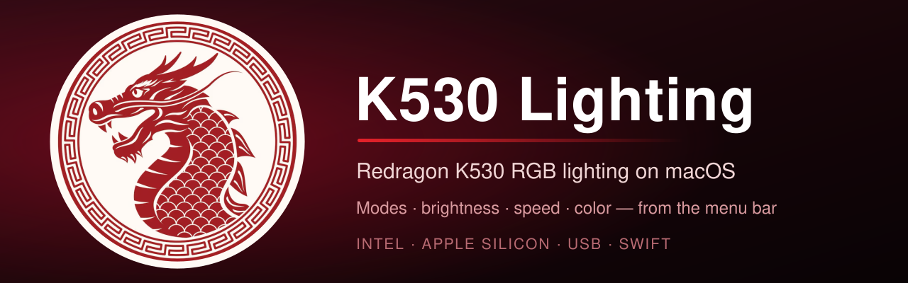

<p align="center"></p>

[Русский](README.md) | **English**

# K530 Lighting

A native macOS app for controlling **Redragon K530 RGB / Draconic** lighting over USB (`0C45:5004`, Sonix). Current version: **0.3.2**, macOS 11+, with one universal installer for **Intel and Apple Silicon**.

This is an unofficial project and is not affiliated with Redragon. The protocol was reverse-engineered from the vendor software and tested on one keyboard; other hardware revisions may differ. **The application interface is currently in Russian.** This repository provides documentation in Russian and English.

## Installation

1. Open the [latest release](https://github.com/Slipcast-dev/Rdragon-K530RGB-Keyboard-Port/releases/latest) and download `K530Lighting-0.3.2-macOS-universal.dmg`. Access to a private repository requires permission and a GitHub login.
2. Quit the old copy, drag `K530Lighting.app` from the disk image to Applications, and eject the image.
3. Open the app. The build is ad-hoc signed and is not notarized; use the standard macOS Open action for an app you trust.
4. Connect the keyboard with a **USB cable**, allow **Input Monitoring** in System Settings, and restart the app. You may need to grant this permission again after an update.

The ZIP contains the same universal `.app` in an alternative package. For troubleshooting, see the [FAQ](docs/FAQ_EN.md). The app's built-in help is currently in Russian.

## Features

- 19 effects, brightness levels 0–4, and five animation speed levels.
- Preset colors, HEX input, the macOS color picker, and multicolor mode.
- Named local profiles with separate saved settings and drafts.
- Preview changes before writing them with Apply (`Применить`); settings are read back to verify the write.
- Restore the initial state and create a backup before the first write.
- A Dock icon while the main panel is open; continued operation in the menu bar after closing it.
- Left-click the menu bar icon to open the panel; right-click for quick settings and app controls.
- Launch at login and built-in help.

App profiles are stored on the Mac. Apply writes the selected settings to **all three hardware profiles** on the keyboard; it does not switch the active hardware profile. Lighting settings remain on the keyboard after the app quits.

## Limitations

- Bluetooth control, macros, key remapping, and firmware updates are not supported.
- Effects 4, 11, 12, 17, 18, and 20 use their own palettes; color selection is disabled for them.
- The preview shows the overall color, not an exact simulation of the hardware animation.
- The arm64 build is included; full acceptance testing on physical Apple Silicon hardware is still required.
- The background updater checks Ed25519 signatures and SHA-256, displays progress, and restarts the app. **While the repository is private, the current unauthenticated updater cannot access its releases**; download updates manually through GitHub. No access token is bundled with the app. [Details](docs/UPDATES_EN.md).

[Completed checks and remaining limitations](docs/VALIDATION_EN.md).

## Development

You need macOS and Command Line Tools (`xcode-select --install`); no third-party libraries or full Xcode installation are required. Run from the repository root:

```sh
./tools/k530menu/test.sh                # checks without a keyboard or network
./tools/k530menu/build.sh universal     # Intel + Apple Silicon
open tools/k530menu/.build/K530Lighting.app
```

`./tools/k530menu/build.sh universal install` copies the build to `~/Applications`, replacing the previous local copy. `./tools/k530menu/package.sh` creates the DMG, ZIP, and signed update files in `dist/`; it requires a release private key stored outside the repository.

- [Architecture, interface behavior, and building](docs/INTERFACE_EN.md)
- [Release packaging and signing](docs/UPDATES_EN.md)
- [HID protocol and supporting device data](research/protocol-findings.en.md)

When changing documentation, update both language versions. Original device dumps are preserved without translation.

## Repository layout

| Path | Purpose |
|---|---|
| `tools/k530menu/` | Swift/AppKit/SwiftUI app, tests, and release scripts |
| `tools/k530diag/` | HID diagnostics and research commands |
| `docs/` | Current help, architecture, and release documentation |
| `research/` | Protocol description and essential data from the physical device |
| `dist/` | Local release artifacts; uploaded to Releases and excluded from Git |

## License and security

New code is distributed under the [MIT License](LICENSE). The license does not cover third-party artwork or vendor materials; see [NOTICE](NOTICE_EN.md). The original icon artwork's terms need to be verified before distribution.

The app does not modify firmware or unknown profile fields. To report a vulnerability, follow the [security policy](SECURITY_EN.md). For other bugs, use Issues and include the app version, macOS version, and status message.
